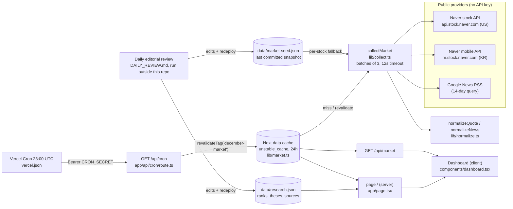

# 12월의 관찰목록 (December Watchlist)

A Korean dashboard that tracks ten US and Korean stocks through 2026-12-31. It shows daily-refreshed prices and news next to dated, sourced watch notes. Live: https://december-stock-radar.vercel.app

## Problem

Stock-pick posts rarely keep their reasons, sources, and dates together, and they go stale quickly. This app keeps a fixed list of ten stocks (7 US, 3 KR) on one screen. Observed market data (quotes, headlines) is kept separate from the dated, source-linked analysis (`thesis`, `risk`, `watch`). Every number carries its own timestamp, and failed or stale data is labeled instead of hidden.

## Architecture



There are two update lanes:

- **Market data**: quotes and headlines refresh automatically. Vercel Cron calls `/api/cron`, which invalidates the cache tag and collects again.
- **Analysis**: theses, ranks, and sources change only through a dated manual or agent review. It follows `DAILY_REVIEW.md`, edits `data/research.json`, and redeploys.

Details are in [docs/architecture.md](docs/architecture.md).

## Key technical decisions

- **One cache, refreshed by cron.** `lib/market.ts` wraps collection in `unstable_cache` (tag `december-market`, 24h fallback). `app/api/cron/route.ts` calls `revalidateTag` and recollects, so page views read the cache. Providers are called only on a cache miss or a revalidation. See [ADR 0001](docs/adr/0001-shared-data-cache-refreshed-by-cron.md).
- **Partial failure keeps the old value and flags it.** `lib/collect.ts` uses `Promise.allSettled` for each stock. When a provider fails, the stock falls back to the committed seed and sets `quoteError`/`newsError`, keeping the original timestamps. The UI shows "이전 자료" when data is older than 36h (`isStale`). See [ADR 0002](docs/adr/0002-seed-fallback-with-visible-error-flags.md).
- **Quotes must prove their identity.** `normalizeQuote` in `lib/normalize.ts` rejects a quote whose symbol, currency, or trade time does not match the request, or whose price is not positive. `normalizeNews` keeps only `https:` links from the last 14 days, removes markup and duplicate titles, and returns at most 3 headlines. See [ADR 0003](docs/adr/0003-reject-quotes-that-cannot-prove-identity.md).
- **Fail-closed cron auth.** `/api/cron` returns 503 when `CRON_SECRET` is unset and 401 on a mismatch. The comparison is constant-time (`lib/auth.ts`, `timingSafeEqual` with a length check). The only secret is server-side; the providers need no API key.
- **The ranking is editorial, not computed.** `rank` in `data/research.json` changes only with a documented reason (`DAILY_REVIEW.md`). Tests enforce 10 unique ids, ranks 1–10, `https` sources, and source dates no later than `reviewedAt`.

## Run locally

Requires Node 22.6+ (tests use `--experimental-strip-types`; verified on Node 22.19.0).

```sh
npm ci
npm run dev          # http://localhost:3106
npm test             # offline unit tests (node:test)
npm run typecheck    # tsc --noEmit
npm run build        # next build
npm run refresh:seed # live collection -> data/market-seed.json (network; exit 1 if any quote fails)
```

`/api/cron` needs `CRON_SECRET` in the environment. Without it, the route returns 503.

## Testing

`npm test` on 2026-10-28 (Node 22.19.0) reported **12 passed / 0 failed / 0 skipped**, across `tests/data.test.ts` (8) and `tests/horizon.test.ts` (4). The tests run offline; the network is stubbed by replacing `globalThis.fetch`. On the same day, `npm run typecheck` and `npm run build` passed.

CI (`.github/workflows/ci.yml`) runs `npm ci`, the typecheck, the tests, and the build on pushes to `main` and on pull requests.

## Limitations / next steps

- This is not real-time data. Quotes come from a once-a-day collection or a cache miss. The "refresh" button reads the same cache.
- The upstream endpoints are public and undocumented (Naver mobile/stock APIs, Google News RSS). A response shape change surfaces as `quoteError` and leaves the old value on screen. The app does not repair the data.
- The editorial lane depends on an outside scheduled agent run and a manual deploy. The repo's `data/research.json` was last committed on 2026-09-15, so the repo can lag behind production.
- In production the fallback is the seed that was deployed, not the last successful server-side quote.
- `collectMarket` batching and the dashboard's sort/filter logic (inline in `components/dashboard.tsx`) have no unit tests.

## Deploy

The app runs on Vercel (`vercel.json`: region `icn1`, cron `0 23 * * *`). Keep `CRON_SECRET` configured in production and never print it.

## Credits

The Pretendard font is bundled under the SIL Open Font License (`public/fonts/LICENSE.txt`). The provenance of the generated images is listed in [docs/asset-register.md](docs/asset-register.md).

## 요약 (Korean)

미국·한국 10개 종목을 2026년 말까지 관찰하는 대시보드입니다. 시세와 뉴스는 Vercel Cron(매일 23:00 UTC = 08:00 KST)이 공유 캐시를 갱신해 자동으로 바뀝니다. 분석 근거와 순위는 날짜와 출처를 붙인 별도 검토로만 바뀝니다. 수집에 실패하면 이전 값과 원래 시각을 유지한 채 실패를 표시하고, 데이터를 지어내지 않습니다.
